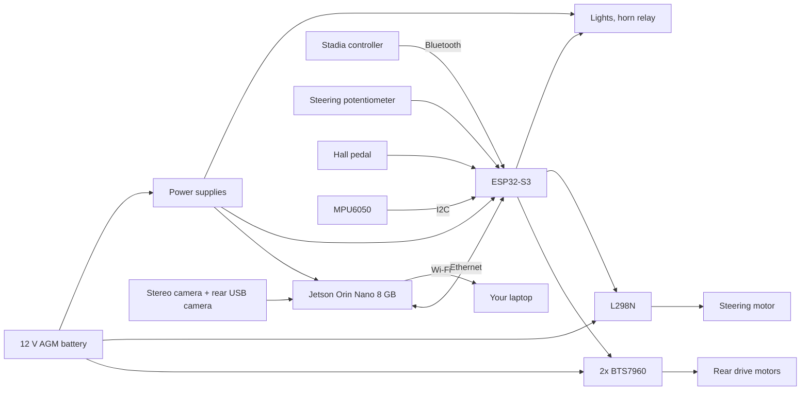

# Hardware

[Back to the README](../README.md)

The car is a 12 V ride-on BMW i8 Concept. The Jetson runs perception and navigation; an ESP32-S3 drives the motors, lights and horn and reads the remote controller.

## Overview

## Components

| Part | Hardware |
|------|----------|
| Chassis | 12 V ride-on BMW i8 Concept, 1.27 x 0.76 x 0.52 m, wheelbase 1.09 m, track 0.64 m, wheel radius 0.14 m |
| Steering | Rigid axle, DC motor on an L298N, absolute angle from a potentiometer read by the ESP32's ADC; max about 15.5 deg (minimum turning radius 4 m) |
| Drive | 2x BTS7960 H-bridges, one per rear wheel |
| Power | 1x 12 V AGM battery |
| Compute | NVIDIA Jetson Orin Nano 8 GB |
| Microcontroller | ESP32-S3 (Waveshare ESP32-S3-ETH), micro-ROS over Ethernet to the Jetson |
| Stereo camera | Waveshare IMX219-83, about 10 cm baseline, on the bonnet, 30 cm above the ground and 20 cm in front of the front axle |
| Rear camera | USB camera |
| IMU | MPU6050 on I2C, published at 50 Hz as `/imu/data_raw` |
| Pedal | Hall accelerator pedal on an ADC input |
| Front lights | PCA9685 PWM driver (I2C `0x40`) |
| Rear lights | 4x 8-pixel WS2812 RGB LED bars (32 pixels in one chain) |
| Horn | Relay on the ESP32 |
| Remote controller | Google Stadia controller with Bluetooth firmware, connected to the ESP32; it always overrides autonomy |
| Network | Jetson Wi-Fi access point `BITT` at `10.42.0.1` |

The ESP32 publishes the wheel encoders as `/wheel_odom` (about 44 Hz) and the battery voltage and e-stop as `/batt_status` (1 Hz), see [software.md](software.md). The simulation does not publish them.

## Controller mapping (Google Stadia controller)

| Input | Action |
|-------|--------|
| Right stick | Drive: up = forward, down = reverse |
| Left stick | Steering: full calibrated range left <-> right |
| A | Horn |
| D-pad left / right | Toggle left / right indicator |
| D-pad up / down | Toggle front / rear lights |
| Capture (screenshot) | Toggle hazard lights |
| Options ("...") | Steering endstop calibration, see below |
| Menu (hamburger, hold 3 s, sticks centred) | Drive distance test, see below |
| Assist | Toggle manual remote / autonomy (autonomy needs a Jetson heartbeat) |

Any stick, pedal or button input takes over from autonomy for a second.

## Steering calibration

Taught by hand once, stored in NVS (survives reboots; without a stored calibration steering is open-loop). Start: hold Options 3 s with sticks centred and car stationary.

1. Controller light solid red: turn the wheels by hand fully to the **right** endstop, press Options.
2. Solid blue: turn the wheels fully to the **left** endstop, press Options.
3. Solid green for 5 s: endstops stored. The car then drives slowly to roughly the middle and measures the gear take-up play - lift the wheels off the ground for this part.

Calibration can also be cancelled by losing the controller connection. While calibrating, drive stays off.
